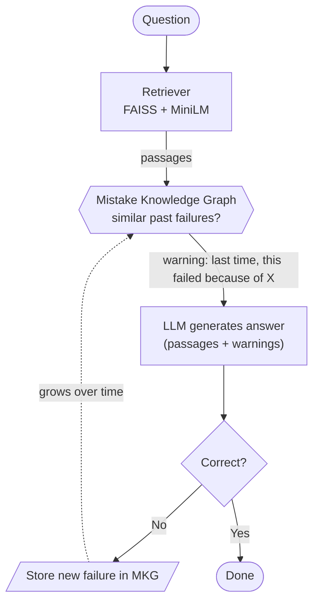
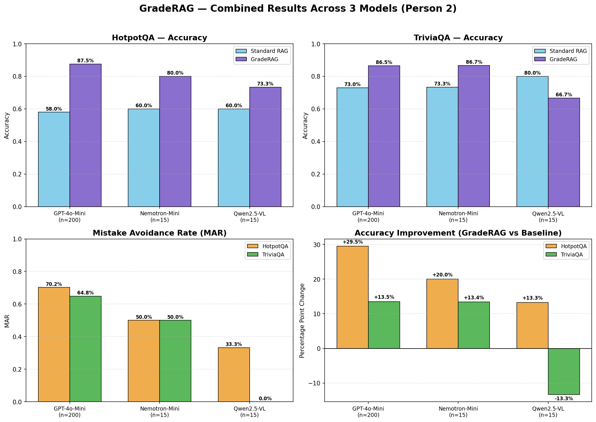
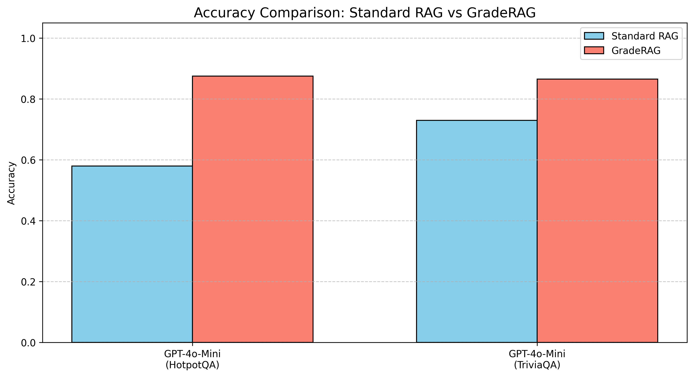
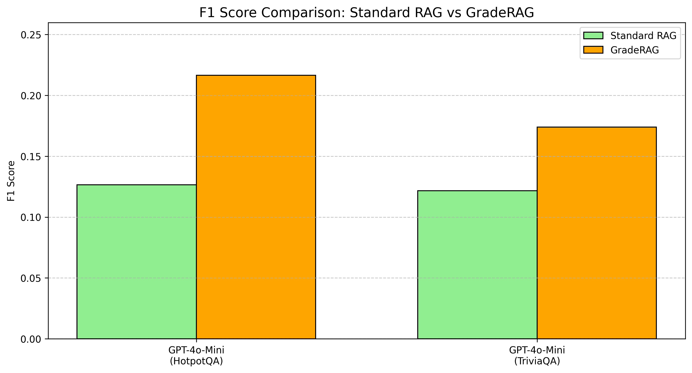
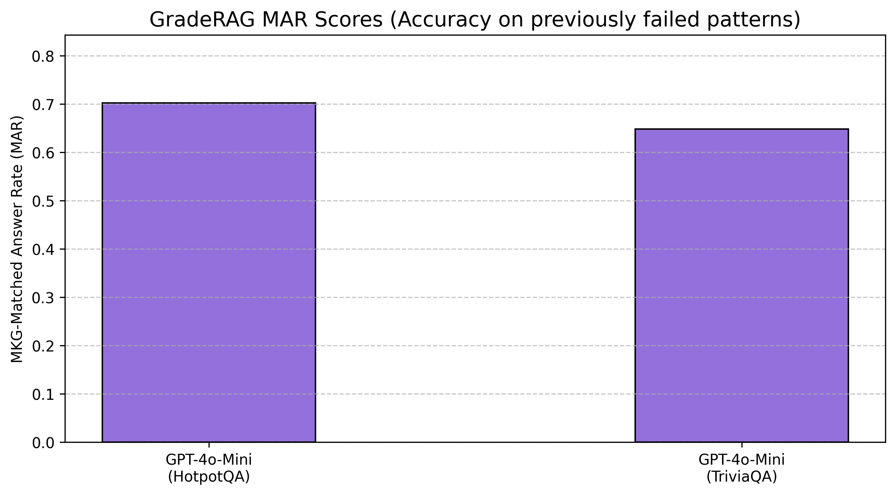
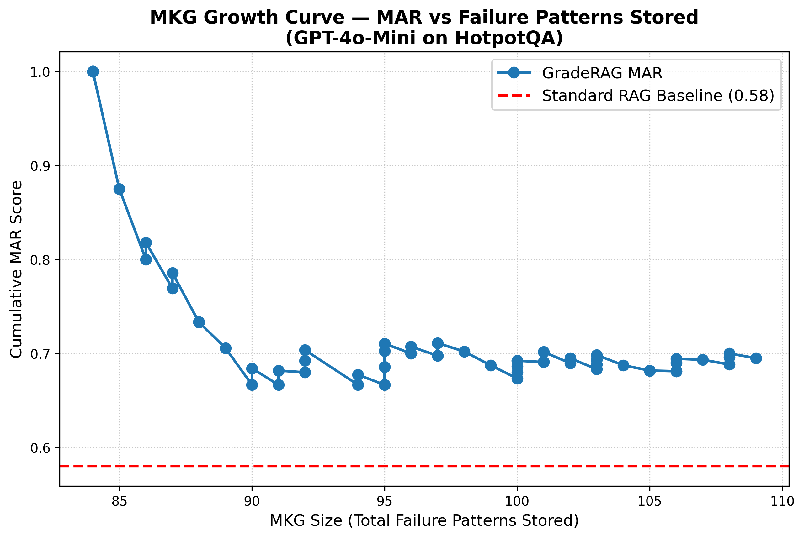

# GradeRAG

**GradeRAG** is a retrieval-augmented generation (RAG) pipeline that **learns from its own
mistakes**. Instead of answering every question from scratch, it keeps a growing
**Mistake Knowledge Graph (MKG)**: whenever the system gets an answer wrong, that failure is
labelled (e.g. *retrieval failure*, *reasoning failure*) and stored. On future questions,
similar past mistakes are pulled back in and used to warn the model away from repeating them.

> **Status:** the paper describing the method is under review. This repository currently
> publishes only the **experimental results and analysis**. The full implementation
> (the MKG, the GradeRAG loop, and the evaluation harness) will be added here once the
> paper is published.

---

## How it works (in one picture)

The MKG is just a vector index of past failures. Each node is one mistake
(`question, wrong_answer, correct_answer, failure_type`); edges link mistakes that are
semantically similar.

**▶ [Explore the Mistake Knowledge Graph — interactive](https://sudarsan2507-hue.github.io/GradeRAG/mkg-explorer.html)**

Drag the nodes, click one to see the real question, what Standard RAG got wrong, and what
GradeRAG corrected it to. ([source](docs/mkg-explorer.html))

---

## Results at a glance

- **Top row — accuracy:** GradeRAG (purple) beats Standard RAG (blue) on 5 of 6
  model/dataset combinations.
- **Bottom-left — Mistake Avoidance Rate (MAR):** how often GradeRAG now gets right the
  kind of question it previously got wrong.
- **Bottom-right — improvement:** percentage-point change vs the baseline. Up to **+29.5 pts**
  (GPT-4o-Mini on HotpotQA). The one regression is Qwen2.5-VL on TriviaQA (−13.3 pts,
  15-question pilot).

### Exact-match accuracy

| Model | Dataset | Standard RAG | GradeRAG | Change |
|---|---|---:|---:|---:|
| GPT-4o-Mini | HotpotQA | 58.0% | **87.5%** | +29.5 |
| GPT-4o-Mini | TriviaQA | 73.0% | **86.5%** | +13.5 |
| Nemotron-Mini | HotpotQA | 60.0% | **80.0%** | +20.0 |
| Nemotron-Mini | TriviaQA | 73.3% | **86.7%** | +13.4 |
| Qwen2.5-VL | HotpotQA | 60.0% | **73.3%** | +13.3 |
| Qwen2.5-VL | TriviaQA | 80.0% | 66.7% | −13.3 |

> GPT-4o-Mini uses 200 questions per dataset. Nemotron-Mini and Qwen2.5-VL are
> 15-question pilots — read them as directional, not definitive.

---

## Why the improvement happens

**1. Accuracy goes up across models**

**2. Answer quality (token-level F1) goes up too**

**3. It actually fixes the mistakes it stores**

MAR = accuracy *restricted to questions that match a stored failure pattern*. ~70% on
HotpotQA means: of the questions GradeRAG previously would have failed, it now answers about
7 in 10 correctly.

**4. The knowledge graph keeps paying off as it grows**

Every point is the running reliability after storing that many failure patterns. The whole
curve sits far above the Standard RAG baseline (red dashed line), and stays there as the
graph fills up.

---

## Experimental setup

| | |
|---|---|
| **Datasets** | HotpotQA (distractor) · TriviaQA (rc) — validation split |
| **Retriever** | `all-MiniLM-L6-v2` sentence embeddings over a FAISS index |
| **Generators** | GPT-4o-Mini · Nemotron-Mini · Qwen2.5-VL |
| **Conditions** | `baseline` = standard RAG · `graderag` = RAG + Mistake Knowledge Graph |
| **Metrics** | exact-match accuracy, token-level F1, faithfulness, MAR, MKG growth curve |

---

## Repository layout

| Path | Contents |
|---|---|
| [`Raw/`](Raw/) | Per-question result CSVs (`results_<model>_<dataset>_<condition>.csv`), qualitative answer comparisons (`examples_*.json`), and the figures above. |
| [`Resprentation/`](Resprentation/) | Aggregated spreadsheet and summary charts. |
| `Code/` | *Not published yet — added on paper publication.* |

**CSV columns:** `id, question, ground_truth, retrieved_docs, predicted, correct, f1_score, faithfulness`
— GradeRAG files add `mkg_matched` (whether a stored failure pattern fired for that query).

---

## License

Code and data in this repository are released under the [MIT License](LICENSE).

## Citation

Citation details will be added when the paper is published.
